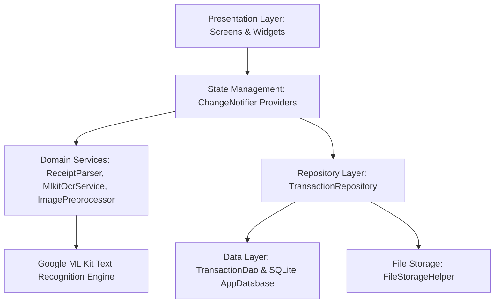

# Receipt OCR & Expense Tracker (VKU)
> **Sổ Thu Chi & Quét Hóa Đơn Thông Minh Dành Cho Sinh Viên**  
> Xây dựng bằng **Flutter + Dart + Google ML Kit + SQLite (`sqflite`)**  
> *Hoạt động 100% Offline • Trí tuệ nhân tạo trên thiết bị (On-Device AI) • Biểu đồ bản địa CustomPainter*

[](https://flutter.dev)
[](https://dart.dev)
[](https://android.com)
[](LICENSE)
[](test/)

---

## 📌 Thông tin sinh viên & Học phần
* **Học phần:** Phát triển ứng dụng di động đa nền tảng (Cross-Platform Mobile App Development)
* **Mini-Project Title:** Project 3: Flutter - Quản Lý Chi Tiêu OCR Hóa Đơn - Flutter (ML Kit)
* **Sinh viên thực hiện:** **Lê Cảm**
* **Mã sinh viên:** **23IT022**
* **Hình thức thực hiện:** Độc lập (100% Contribution)
* **Đơn vị đào tạo:** Trường Đại học Công nghệ Thông tin và Truyền thông Việt - Hàn (VKU) – Đại học Đà Nẵng
* **🔗 GitHub Repository:** [https://github.com/CAMLC25/camle-vku-receipt_ocr_expense_tracker](https://github.com/CAMLC25/camle-vku-receipt_ocr_expense_tracker)
* **📦 Tải APK Release:** [Download app-release.apk](https://github.com/CAMLC25/camle-vku-receipt_ocr_expense_tracker/releases/download/v1.0.0/app-release.apk)

---

## 📱 Giới thiệu tổng quan

**Receipt OCR & Expense Tracker** là ứng dụng di động hoàn chỉnh giúp sinh viên đại học và thủ quỹ câu lạc bộ số hóa, quản lý và theo dõi các khoản chi tiêu hằng ngày thông qua ảnh chụp biên lai, hóa đơn bán lẻ hoặc ảnh chụp màn hình chuyển khoản ngân hàng (VietQR / Napas247 / MoMo / ZaloPay).

Ứng dụng hoạt động **hoàn toàn ngoại tuyến (Offline-First)**:
- **100% On-Device AI**: Sử dụng mô hình Google ML Kit Text Recognition chạy trực tiếp trên thiết bị (On-Device), bảo vệ tuyệt đối quyền riêng tư tài chính cá nhân, không gửi ảnh lên Cloud.
- **Tiền xử lý ảnh siêu phân giải (Image Preprocessor)**: Tự động nội suy phóng to Bicubic ($\ge 1500$px) và tăng tương phản 35% trên background Isolate, nhận dạng chính xác kể cả ảnh chụp mờ hoặc hóa đơn in nhiệt phai màu.
- **Không phát sinh chi phí API**: Hoạt động không cần kết nối mạng hay trả phí Google Cloud Vision / OpenAI API.
- **Biểu đồ bản địa (Native CustomPainter)**: Tự vẽ biểu đồ hình vành khuyên (Donut Chart) và biểu đồ cột xu hướng 7 ngày (Weekly Bar Chart) bằng Flutter Canvas API & `AnimationController`, không dùng thư viện ngoài.

---

## 📸 Giao diện ứng dụng thực tế (Screenshots)

| Trang chủ (Dashboard) | Bộ lọc Lịch sử (History) |
| :---: | :---: |
|  |  |
| *Thẻ số dư tháng, phím Quét tích hợp chính giữa NavigationBar, danh sách giao dịch gần nhất.* | *Bộ lọc đa tầng (Tất cả / Chi / Thu / Danh mục) với InputChip xóa nhanh và từ khóa.* |

| Biểu đồ Thống kê (CustomPainter) | Cài đặt & Bản quyền VKU |
| :---: | :---: |
|  |  |
| *Biểu đồ cột 7 ngày tự vẽ Canvas, phân bổ chi tiêu trực quan chuẩn định dạng tiếng Việt.* | *Tùy chọn giao diện SegmentedButton (Sáng/Tối/Hệ thống), cam kết 100% On-Device.* |

---

## ✨ Tính năng chính

| Phân hệ | Chi tiết tính năng nổi bật |
|---|---|
| 📸 **Thu thập ảnh thông minh** | Chụp trực tiếp từ Camera thiết bị hoặc chọn ảnh hóa đơn/ảnh chuyển khoản có sẵn trong Thư viện ảnh. |
| ⚡ **Image Preprocessor Pipeline** | Chạy trên background Isolate: Tự động phóng to ảnh nhỏ $< 1500$px bằng thuật toán Bicubic Interpolation và tăng tương phản $1.35$ lần giúp tách biệt chữ in nhiệt khỏi nền giấy. |
| 🔍 **On-Device OCR & Dual-Pass** | Nhận diện ký tự quang học offline tốc độ cao, hỗ trợ cơ chế quét kép (ảnh gốc + ảnh tiền xử lý) và bảng xem văn bản thô `RawOcrSheet` sao chép clipboard. |
| 🏷️ **Phân loại văn bản tự động** | Phân loại chính xác 5 nhóm tài liệu: Hóa đơn bán lẻ (`receipt`), Ảnh chuyển khoản (`bankTransfer`), Ví điện tử (`eWallet`), Hóa đơn điện nước EVN (`utilityBill`), hoặc Chưa xác định (`unknown`). |
| 🧠 **Vietnamese Heuristic Parser** | Thuật toán tái cấu trúc dòng không gian (**Spatial Visual Row Reconstruction**), bóc tách chuẩn xác tổng tiền thực trả (loại trừ tiền khách đưa, tiền thối, chiết khấu, tạm tính), ngày giờ và mã tham chiếu. |
| 🎯 **Smart Entity & Category** | Bộ đối sánh 2 tầng (**Dual-layer Accented & Non-accented**) chuẩn hóa chuỗi không dấu, phân loại chuẩn xác Ăn uống, Siêu thị, Di chuyển, Học phí... kể cả với hóa đơn không dấu như `QUAN AN THIEN TAN`. |
| 🛡️ **Xác minh trước khi lưu** | Màn hình `ReviewScreen` hiển thị badge phân loại ảnh, điểm tin cậy OCR (Confidence Score), cảnh báo viền cam khi thiếu thông tin, cho phép chỉnh sửa toàn bộ trước khi ghi sổ. |
| 💾 **Lưu trữ cục bộ SQLite** | Cơ sở dữ liệu SQLite (`sqflite`) với đơn vị tiền tệ số nguyên VNĐ (`INTEGER`), truy vấn tham số hóa chống SQL Injection, đánh chỉ mục (`Index`) tăng tốc. |
| 🖼️ **Quản lý ảnh an toàn** | Sao chép ảnh vào sandbox ứng dụng (`receipt_images/<uuid>.jpg`), lưu đường dẫn tương đối và tự động dọn sạch ảnh mồ côi khi xóa giao dịch. |
| 📊 **Trực quan hóa bản địa** | Biểu đồ Donut phân bổ danh mục và biểu đồ cột 7 ngày tự vẽ bằng `CustomPainter`, kèm bộ chọn tháng linh hoạt. |
| 🎨 **Material 3 UI** | Chuẩn thiết kế Fintech hiện đại, nút Quét hóa đơn tích hợp chính giữa thanh điều hướng đáy, hỗ trợ Dark/Light Theme qua `SegmentedButton`. |

---

## 🏗️ Kiến trúc dự án (Feature-First Clean Architecture)

Dự án áp dụng mô hình **Feature-First Clean Architecture** kết hợp mẫu thiết kế **Repository Pattern** phân tách độc lập giữa giao diện, tầng nghiệp vụ và cơ sở dữ liệu:



```text
lib/
├── app.dart                                # Navigation Shell & Multi-tab NavigationBar
├── main.dart                               # App Entrypoint & Provider Registrations
├── core/
│   ├── constants/                          # AppColors, AppConstants, RegexPatterns
│   ├── errors/                             # Failure domain exceptions
│   ├── theme/                              # Light & Dark Theme Data (Material 3)
│   └── utils/                              # CurrencyFormatter, DateFormatter, VietnameseOcrNormalizer
├── data/
│   ├── database/                           # AppDatabase (SQLite), TransactionDao (CRUD & Aggregations)
│   ├── models/                             # TransactionModel, ParsedReceipt, SpendingSummary
│   └── repositories/                       # SqliteTransactionRepository, InMemoryRepository
└── features/
    ├── dashboard/                          # DashboardScreen, SummaryCard, RecentTransactionTile
    ├── ocr/                                # MlkitOcrService, ImagePreprocessor, ReceiptParser, RawOcrSheet
    ├── scanner/                            # ImageInputScreen (Camera & Gallery Selector)
    ├── settings/                           # SettingsScreen, SegmentedButton Theme
    ├── statistics/                         # StatisticsScreen, DonutChartPainter, WeeklyBarChartPainter
    └── transactions/                       # ReviewScreen, TransactionDetailScreen, HistoryScreen
```

---

## 🧪 Kết quả kiểm thử tự động (57/57 Tests Passing - 100%)

Hệ thống kiểm thử tự động đa tầng đảm bảo tính ổn định và chống suy thoái logic:

* **20 Tests — Receipt Parser & Document Detection (`test/ocr/receipt_parser_test.dart`)**:
  - Hóa đơn nhà hàng, cà phê, siêu thị, vé máy bay.
  - Phân biệt số tiền thực trả so với tiền khách đưa, tiền thối lại và tạm tính.
  - Ảnh chụp chuyển khoản ngân hàng (Napas247 / VietQR / MB Bank / Vietcombank).
  - Chuẩn hóa các định dạng ngày `dd/MM/yyyy`, `dd-MM-yyyy`, `yyyy-MM-dd`.
  - Nhận diện phân loại ảnh: `receipt`, `bankTransfer`, `eWallet`, `utilityBill`, `unknown`.
* **11 Tests — SQLite DAO & Data Aggregations (`test/database/transaction_dao_test.dart`)**:
  - Toàn bộ chu trình CRUD trên in-memory SQLite (`sqflite_common_ffi`).
  - Lọc đa tiêu chí an toàn tham số hóa, tính toán số dư ròng, tổng thu chi và phân bổ 7 ngày.
* **8 Tests — Vietnamese OCR Normalizer (`test/ocr/vietnamese_ocr_normalizer_test.dart`)**:
  - Chuẩn hóa lỗi font chữ in nhiệt, loại bỏ dấu tiếng Việt chuẩn Unicode, trích xuất số tiền.
* **4 Tests — Image Preprocessor (`test/ocr/image_preprocessor_test.dart`)**:
  - Kiểm thử phóng to ảnh nhỏ lên $\ge 1500$px, tăng tương phản 35% và giữ nguyên ảnh lớn.
* **1 Test — ML Kit OCR Spatial Reconstructor (`test/ocr/mlkit_ocr_service_test.dart`)**:
  - Kiểm thử gom dòng theo tọa độ không gian (Vertical Overlap $> 35\%$).
* **13 Tests — Widget & Screen Interactions (`test/widgets/`)**:
  - `review_screen_test.dart`: Gợi ý OCR, validation form khi để trống trường bắt buộc, lưu dữ liệu.
  - `transaction_detail_screen_test.dart`: Hiển thị chi tiết, xem ảnh phóng to, dialog xác nhận xóa.
  - `statistics_screen_test.dart`: Chuyển đổi tab biểu đồ Donut và Bar Chart, lọc tháng.
  - `widget_test.dart`: Khởi chạy ứng dụng và điều hướng Bottom Navigation Bar.

---

## 🚀 Hướng dẫn cài đặt và chạy ứng dụng

### 1. Yêu cầu môi trường
* **Flutter SDK**: `>= 3.24.0` (Khuyên dùng Flutter 3.27+ hoặc 3.47+)
* **Dart SDK**: `>= 3.5.0`
* **Android SDK**: `minSdkVersion 21`, `targetSdkVersion 34`
* **Java Development Kit (JDK)**: JDK 17

### 2. Cài đặt các gói phụ thuộc
```bash
flutter pub get
```

### 3. Chạy kiểm thử tự động (Unit & Widget Tests)
```bash
flutter test
```

### 4. Kiểm tra phân tích tĩnh mã nguồn (Static Analysis)
```bash
flutter analyze
```

### 5. Chạy ứng dụng trên thiết bị / máy ảo Android
```bash
flutter run
```

### 6. Đóng gói tệp cài đặt Release APK
```bash
flutter build apk --release --no-tree-shake-icons
```
*Tệp APK hoàn chỉnh sau khi đóng gói sẽ nằm tại: `build/app/outputs/flutter-apk/app-release.apk` (Dung lượng: ~85.9 MB, chứa sẵn ML Kit Offline).*

---

## 📑 Danh mục tài liệu kỹ thuật trong dự án

* [Báo cáo kỹ thuật đồ án (Technical Report)](docs/technical_report.md)
* [Kiến trúc hệ thống (Architecture)](docs/architecture.md)
* [Lược đồ cơ sở dữ liệu SQLite (Database Schema)](docs/database_schema.md)
* [Kế hoạch kiểm thử (Test Plan)](docs/test_plan.md)
* [Kế hoạch triển khai (Implementation Plan)](docs/implementation_plan.md)

---

## 👨‍💻 Tác giả
* **Sinh viên:** Lê Cảm — Mã SV: **23IT022**
* **Trường:** Đại học Công nghệ Thông tin và Truyền thông Việt - Hàn (VKU)
* **Khoa:** Khoa Khoa học Máy tính
